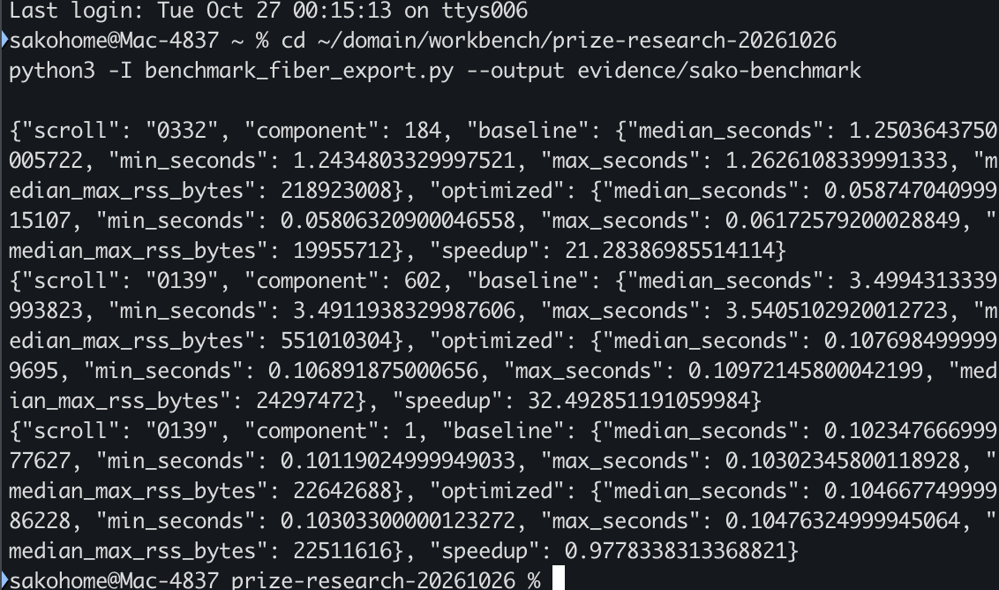

# Faster single-fiber JSON export

Export one annotated fiber without serializing the rest of its connected component.

The four-file change is published at [commit 2c50a2d](https://github.com/RhoAias1/villa/commit/2c50a2d40dbe4ed48a9e4b5e4ecf7511d94283e2), based on upstream `39a8cf3a124bdd5540ee826e1cb30047c8dc8c85`.
The [standalone patch](submission.patch) has SHA-256 `62bb5b1c679510607c1e8640d0ddd1af7845de9a9da2e11cf232a80f58d63b8e`.

## Real example and measured result

Starting with the public PHerc0332 and PHerc0139 fiber annotations, this study built object stores using the unchanged upstream importer, then exported a single fiber with `vc_object_export --db STORE --uuid UUID --output FILE.json`.
Before this change, the exporter encoded the root's entire connected component and discarded all but one result. The proposed path encodes the requested fiber and its incident branch information.

Sarkis (Sako) Avetisyan personally reran the paired benchmark and supplied the original terminal screenshot below. It is copied unchanged from his supplied image. The implementation and experiment preparation were AI-assisted; this screenshot documents the human rerun, not personal authorship of every command or a claim of downstream annotation-team adoption.

| Requested fiber | Component size | Baseline median | Proposed median | Baseline / proposed | Peak RSS, baseline → proposed |
|---|---:|---:|---:|---:|---:|
| PHerc0332 `dj_20260810T113807458_000001.json` | 184 | 1.25036 s | 0.05875 s | **21.28×** | 218.92 → 19.96 MB |
| PHerc0139 `dj_20260902T151037604_000001.json` | 602 | 3.49943 s | 0.10770 s | **32.49×** | 551.01 → 24.30 MB |
| PHerc0139 isolated control `lt_20261007T084812276_000336.json` | 1 | 0.10235 s | 0.10467 s | **0.978×** | 22.64 → 22.51 MB |

The isolated control was about 2.3% slower in this rerun. These are three selected cases, not a universal or end-to-end pipeline speed claim. Five paired trials per binary and case follow one excluded warmup; order alternates. Timing includes process launch. RSS is the median of process maxima from macOS `/usr/bin/time -l`. MB means 1,000,000 bytes. See [all human-rerun measurements](evidence/sako-benchmark/summary.json) and adjacent raw timing logs.

The earlier audited run is preserved separately: **20.36× / 32.00× / 1.04×**. See its [measurements](evidence/export-final-benchmark/summary.json) and [chart](audited-benchmark.png). The auditor also independently reproduced the two large speedups. The human rerun used the same audited binary hashes.

## Usefulness and limits

Fiber annotations are inputs to scroll geometry and tracing workflows. This contribution reduces the cost of retrieving one fiber from a large linked group for inspection or export. The JSON format and valid-data output remain unchanged, so callers of the existing CLI and `exportGeometry` API receive the improvement without a new format or workflow.

It does not discover letters, improve segmentation quality, or demonstrate a measured increase in the probability of reading a scroll. Its demonstrated benefit is lower export latency and memory use on these public annotations. Community adoption and any end-to-end effect remain to be established.

Single-fiber export validates its requested payload and incident branch anchors. Malformed data elsewhere in the connected component or a broken nonincident edge may no longer prevent that export. The full-network API retains its previous behavior. `byteBudget` bounds requested geometry materialization; branch-anchor lookups separately read peer control points, so it is not a total-process memory limit.

## Correctness and regression checks

- **875/875 fibers:** individual exports and the proposed full-network exports are byte-identical to an independently compiled, unmodified upstream network encoder. This covers 255 PHerc0332 fibers and 620 PHerc0139 fibers, 34,993 control points, 3,030,527 line points, and 842 edges. [Summary](evidence/export-final-validation/summary.json); [PHerc0332 output hashes](evidence/export-final-validation/0332/files.json); [PHerc0139 output hashes](evidence/export-final-validation/0139/files.json).
- Original point positions, 624 known level-0 volume bindings, original download hashes, and input-store hashes were checked.
- macOS CTest: **8/8**. Linux CTest: **8/8**. Linux Python suite: **34/34**. [macOS log](evidence/export-final-tests.log), [Linux C++ log](evidence/linux-export-final-tests.log), [Linux Python log](evidence/linux-export-final-python-tests.log).
- The final fixture-only correction was rerun on [macOS](evidence/export-orientation-tests.log) and [Linux](evidence/linux-export-orientation-tests.log). Production source and measured binaries were unchanged; see [binary identity checks](evidence/export-final-binary-check.json).
- Added tests cover a large linked peer under a 1 KiB requested-geometry budget and geometry-less peers stored in both relationship endpoint positions. Existing orientation, revision, pin, branch and Python-contract checks remain in place.
- Independent **Claude Opus 5.5, max** review: [final PASS](audit-verdict.txt) and [model/effort receipt](audit-model.json). It included adversarial mutations of the missing-geometry guards. This is an AI technical audit, not an organizer review or a guarantee of prize eligibility.

The changes are limited to `FiberJson.hpp`, `FiberJson.cpp`, `GeometryExport.cpp`, and `test_object_store_fiber_json.cpp`. The importer and Python interface are unchanged. [Patch-integrity evidence](evidence/export-patch-check.json).

## Reproduce

See [REPRODUCE.md](REPRODUCE.md) for a clean-checkout recipe, frozen public input manifests, build/test commands, and the benchmark and corpus-check scripts. [Environment](evidence/export-environment.json): Apple M3, 8 logical CPUs, 16 GiB RAM; macOS 26.6.2 and an arm64 Linux container on the same host. They are two OS/compiler environments, not independent hardware samples. macOS Python was not tested because of the pre-existing reader build issue tracked in [PR #2300](https://github.com/ScrollPrize/villa/pull/2300).

## Data, prior work, and licensing

- Public annotation sources: [PHerc0332](https://dl.ash2txt.org/other/annotators/0332_fibers/) and [PHerc0139](https://dl.ash2txt.org/other/annotators/0139_fibers/), Vesuvius Challenge, **CC BY-NC 4.0**. Frozen manifests record every downloaded URL, size, and SHA-256. Raw annotation data are not relicensed as code or bundled here.
- The unchanged upstream importer reads copies with the `version` value changed from 4 to 3. This reference route and the published import counts are **prior work by ChaseHendrick**, [issue #2320](https://github.com/ScrollPrize/villa/issues/2320) and [PR #2321](https://github.com/ScrollPrize/villa/pull/2321). This submission claims no new import fix. [Input provenance](evidence/export-databases/provenance.json).
- Code remains under villa's [MIT license](LICENSE). Original reproduction scripts and report text are also released under MIT. Upstream copyright notices are preserved. The human terminal screenshot is provided as submission evidence.
- AI assistance: OpenAI Codex led implementation and experiments; Claude Opus 5.5 performed the independent technical audit. Sarkis Avetisyan is the human submitter and benchmark operator. AI tools are not additional human prize recipients.

## Evidence handling

Published text evidence replaces the original absolute research-workspace prefix with `<WORKSPACE>`; measured values, command arguments after that prefix, and content hashes are unchanged. The two image files are byte-for-byte copies. [SHA256SUMS](SHA256SUMS) covers this curated package. Private messages, authentication material, and raw AI session transcripts are excluded. The audit verdict is the permitted final response, not private reasoning.
